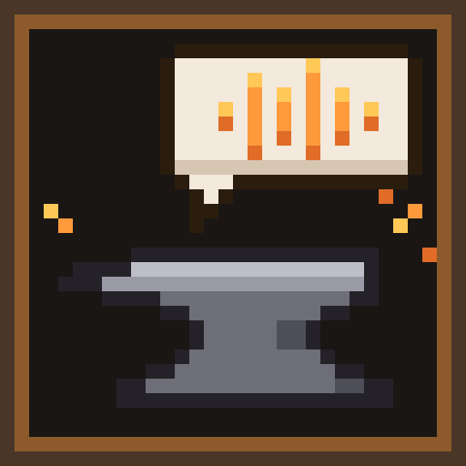
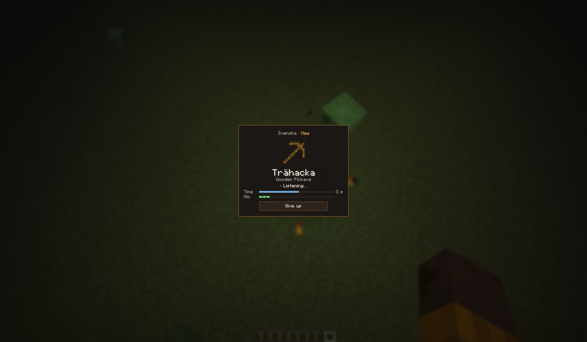
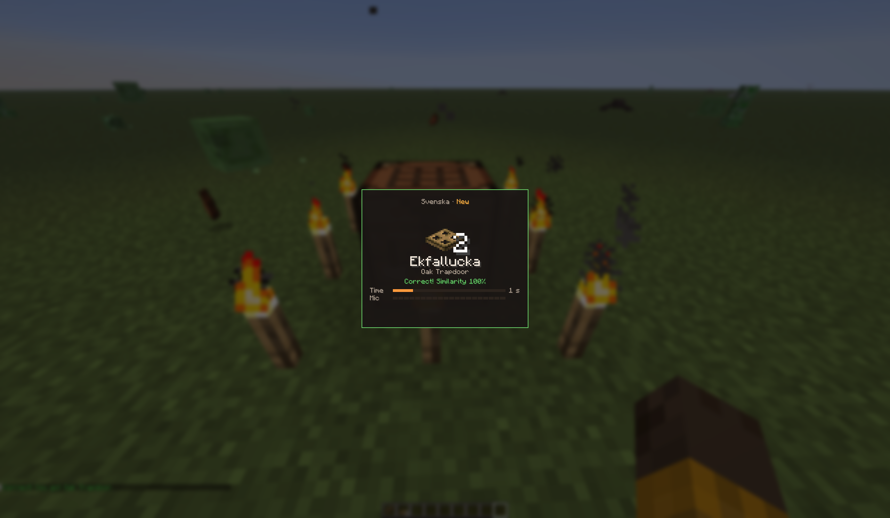
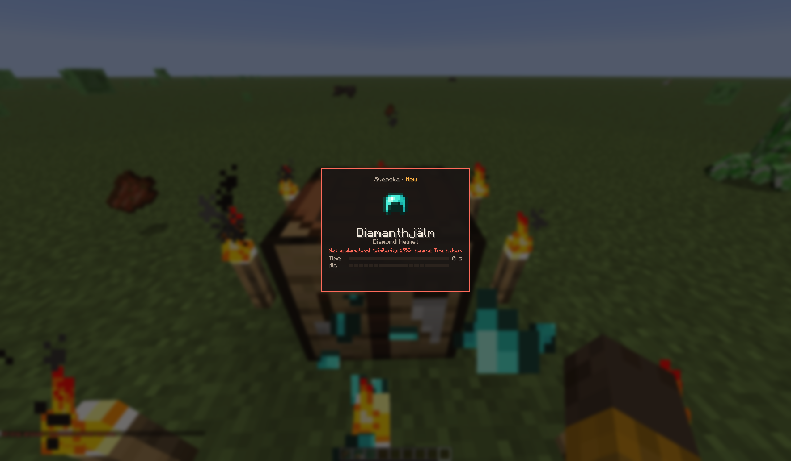
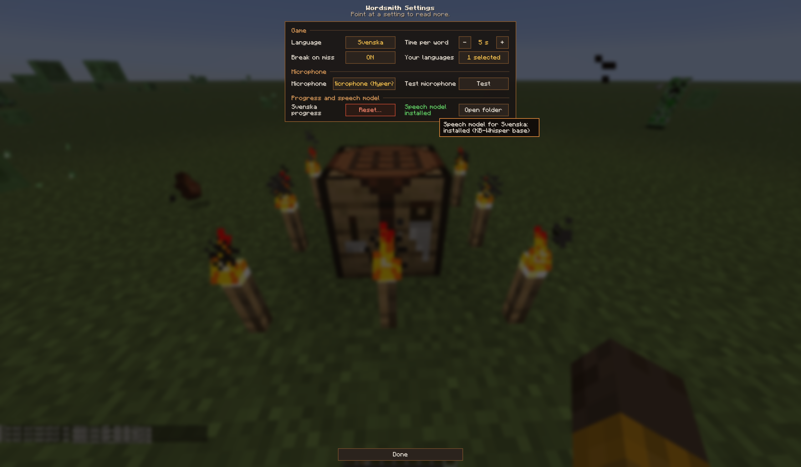
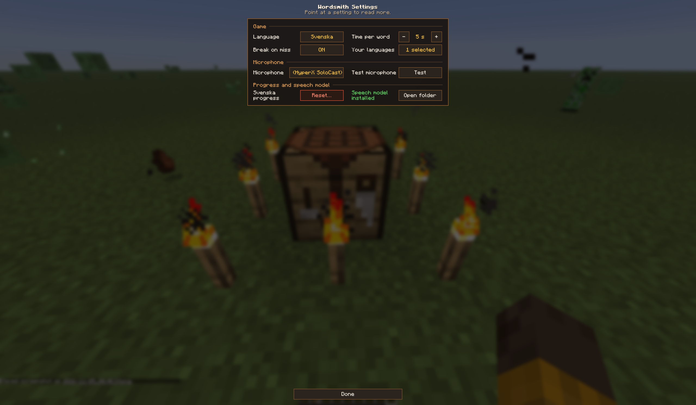

#  Wordsmith

**Say it to forge it.** A Minecraft mod for practicing the pronunciation of a foreign language.

When you craft an item, Wordsmith shows it with its name in the language you are learning, for example
Swedish **Trähacka** above the English *Wooden Pickaxe*. Say the name out loud before the time runs out:

- **Said right** → you get the item, and the word counts as learned. You won't be asked for it again.
- **Wrong, unclear, out of time or "Give up"** → the ingredients are already used, and the item breaks.
  The word stays unlearned and comes back the next time you craft it.

The name is on the screen, so this is not a translation quiz: it checks **how you say it**. Speech
recognition runs **entirely on your computer**; no account, no API key, no cloud service.

  
  

## Features

- **Crafting challenges** at the crafting table and in the 2×2 inventory grid. Shift-click crafts one full stack
  as a single challenge.
- **Practice menu** (default key **K**): words you missed and words you know. Practice any of them without risk:
  nothing is given or broken.
- **Similarity score** after each answer (how close what was heard is to the name).
- **Achievements** for learned words, streaks, fast answers and complete tool and armor sets.
- **Several languages**: pick the languages you learn and switch between them; progress is kept per language.
- **Multiplayer**: works on servers that have the mod installed.

## Installation

1. Install **Minecraft Java Edition 26.3** with **[Fabric Loader](https://fabricmc.net/use/) 0.20.1 or newer**.
2. Download **[Fabric API](https://modrinth.com/mod/fabric-api)** for 26.3 and put it in your `mods` folder.
3. Download the Wordsmith jar from **[Releases](../../releases)** and put it in your `mods` folder.
4. Start the game. Open the practice menu (**K**) → **Settings…** → **Your languages**, select your language and
   click **Download** to get its speech model (about 40–60 MB, once).

The default language is Swedish. Without a speech model the game cannot listen to you; you will see a message in
chat, and crafting works as usual.

**Multiplayer:** install the mod on the server **and** on each player's game. Players without the mod on their
game craft normally, without challenges.

## Languages

| Language | Status | Speech recognition |
|---|---|---|
| Swedish (`sv_se`) | **Tested** | KB-Whisper base (KBLab, National Library of Sweden) + sound comparison |
| German (`de_de`) | **Tested** | Vosk small German |
| Catalan, Czech, Dutch, English, Esperanto, French, Georgian, Hindi, Italian, Kazakh, Kyrgyz, Persian, Polish, Portuguese, Russian, Spanish, Turkish, Ukrainian, Uzbek, Vietnamese | Experimental | Vosk small models |

**Tested** means the recognition settings were measured on labeled recordings of correct and wrong
pronunciations. **Experimental** languages work, but have not been measured: there a wrong answer does
**not** break the item by default (you can change this in Settings → **Break on miss**).

Item names come from Minecraft's own translations for that language.

## Controls

| Key / button | What it does |
|---|---|
| Speak | Say the name shown on the challenge screen. Just speak; there is no button to hold. |
| **Give up** | Ends the challenge as a wrong answer (the item breaks). Esc does nothing during a challenge. |
| **K** | Practice menu (change it in Options → Controls → Key Binds → *Wordsmith*). |
| Click a word | Practice it. Arrow keys + Enter also work. |
| **Settings…** | In the practice menu: active language, time per word (3–15 s), **Break on miss**, microphone and microphone test, speech model, reset progress. |

## Privacy

- **Recognition is offline.** Your voice is processed on your computer by Vosk or whisper.cpp and never leaves it.
- **No audio is saved.** Wordsmith does not write recordings to disk and does not send them anywhere.
- **The microphone is only on during a challenge** (or for 5 seconds when you press **Test microphone** in
  Settings, which only shows the level).
- **No telemetry, no accounts.** Your progress is stored locally in `config/wordsmith/progress/`.

## Internet use

Wordsmith only connects to the internet when **you click Download** in **Your languages** (or accept a download
offer). It downloads from the original publishers, over HTTPS only:

- **alphacephei.com** — Vosk speech models (German and experimental languages)
- **huggingface.co** (and its download servers) — KB-Whisper model for Swedish, from KBLab

Every download is checked against a SHA-256 hash built into the mod and is removed if it does not match.
Models are saved in `config/wordsmith/models/`. Nothing else is downloaded, and nothing is uploaded.

## System requirements

- Minecraft 26.3, Fabric Loader 0.20.1+, Fabric API. Java 25 (included with the official launcher).
- A microphone.
- About 40–60 MB of disk space per language for the speech model (up to three times that during the download).
  The mod jar itself is about 30 MB because it contains the speech engines for all platforms.
- **Windows:** 64-bit. Swedish (whisper.cpp) needs a CPU with **AVX2** (most CPUs from 2013 on, Intel Haswell /
  AMD Excavator or newer). Without it, Swedish shows "Not available on this computer" and you get crafted
  items without a challenge.
- **macOS:** Apple Silicon or Intel. Allow microphone access for your launcher: **System Settings → Privacy &
  Security → Microphone**, turn on your launcher (e.g. Minecraft Launcher, Prism Launcher), then restart it.
  Without permission the game hears silence and tells you so.
- **Linux:** x86-64.

## Known limitations

- Only the crafting table and the inventory crafting grid. Stonecutter, smithing table, anvil and other stations
  are not included.
- Shift-click crafts at most one stack per challenge.
- If you leave the game during a challenge, that item is lost.
- Recognition is not perfect. In Swedish, a wrong form that differs from the right word by only one vowel is
  sometimes accepted. In German, recognition is a little forgiving of unclear pronunciation.
- The similarity score shows how close the heard text is to the name; it is not a pronunciation grade.
- A learned word is not asked again (no spaced repetition yet); use the practice menu to review.
- Languages written without spaces (Chinese, Japanese, Korean) are not supported.
- The microphone can't be shared with programs or mods that hold it exclusively (e.g. some voice chat mods).
  You get the item and a message instead.

## Reporting problems

Please open an **[issue](../../issues)**. It helps a lot to include:

- what happened and what you expected,
- your operating system, launcher and the Wordsmith version,
- the language you were practicing,
- your `logs/latest.log` (lines containing `Wordsmith`, `whisper`, `Vosk` or `Microphone` are the most useful).

Please do **not** attach voice recordings.

## License

Wordsmith is **not open source**. You may play it, make videos and streams with it, and include it unchanged in
modpacks. Re-uploading it elsewhere and distributing modified versions are not allowed. See [LICENSE](LICENSE).

Wordsmith uses third-party components (Vosk, Kaldi, whisper.cpp, whisper-jni, and downloadable models from Alpha Cephei and KBLab) under their own licenses. See [NOTICE](NOTICE) and
[licenses/](licenses).

Minecraft is a trademark of Mojang AB. Wordsmith is not an official Minecraft product and is not approved by or
associated with Mojang or Microsoft.
